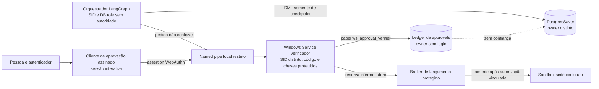

# Fase B: desenho revisável do verificador local protegido

**Estado: preparado em documentação, não implantado nem testado em PostgreSQL.** Este desenho não habilita `work` ou `review` reais. As duas CLIs continuam retornando `CODEX_STAGE_DISABLED`; não há serviço Windows, conta separada, ACL, chave, credencial WebAuthn ou papel PostgreSQL criado por esta fase.

## Base observada e decisão de fronteira

- A fase A implementa envelope v1 e mock SQLite em `approval_contract.py`/`approval_mock.py`. O mock publica prova falsificável e `usable_for_real_work=false`; não entra no grafo. A migration `000005` descreve as tabelas `work_approval_credentials`, `work_approval_challenges` e `work_approvals`, mas só foi exercitada em SQLite em memória. O contrato v1 permite **somente `stage=work`, `attempt=1`**. `review` real exige contrato e revisão separados; não reutilizar o recibo de work.
- O `PostgresSaver` usa `checkpoints`, `checkpoint_blobs`, `checkpoint_writes` e `checkpoint_migrations`. `development.cli` **e** `workflow.py` chamam `saver.setup()` em toda invocação; `workspace.py` constrói `DEVELOPMENT_CHECKPOINT_DSN` a partir da configuração Laravel atual, que usa superuser. O fluxo de suporte também reutiliza essa configuração para dados de aplicação e checkpoint. A separação requer quatro DSNs de runtime distintos (aplicação, checkpoint, verificador e broker), além do DSN de migração exclusivamente offline; não basta trocar grants no ledger. `workspace.py`, `development.cli` e a entrada do grafo bloqueiam os estágios Codex reais. O checkpoint e recibos sob `tmp` são graváveis pelo orquestrador e não podem ser fonte de autorização.
- O handoff informa WebAuthn API v9 presente no Windows. Isso comprova disponibilidade de API, não um RP ID/origin válido, autenticador com UV, registro, verificação de assinatura ou proteção de serviço.

### Diagrama de confiança proposto

O serviço valida e persiste a decisão; **somente o broker protegido**, sob identidade e papel de banco próprios, pode transicionar `reserved -> launching` e criar processo. O verificador insere `reserved` na transação de consumo, mas não possui UPDATE no claim; o agente só pode pedir status. **Nenhum token entregue ao orquestrador autoriza execução.** O serviço reobserva spec, plano, repo canônico, HEAD, inventário, allowlist e alvo na emissão e no consumo; o broker repete a observação depois de receber a reserva e imediatamente antes do spawn. A mesma identidade do snapshot (hash de árvore e metadados protegidos) deve constar do claim e ser comparada nesses pontos. Se não conseguir observar arquivos com integridade, falha fechado. Para work, o diretório sintético ainda é gravável pelo SID atual: checagens de symlink, junction, hardlink, `.git`, árvore limpa e hash de inventário não eliminam TOCTOU. Antes do claim, o broker cria snapshot por cópia verificada em volume/diretório cujo DACL nega escrita, troca, delete e mudança de ACL ao SID do agente, inclusive ancestrais e `.git`; não executa sobre a árvore viva. Deve confirmar SID/ACL efetivos, ausência de hardlinks/reparse points e digest do snapshot após a cópia e antes do spawn; o processo recebe somente esse snapshot e uma área de saída separada e restrita. Se o executor precisar escrever, usar camada de trabalho isolada do SID do agente com diff conferido contra o snapshot; sem prova de isolamento e comparação após execução, no-go.

## Threat model e controles

| Ameaça | Consequência | Controle/limite do desenho |
|---|---|---|
| Agente e UI com o mesmo SID atual | Modifica código, mock, checkpoint, arquivos ou simula mensagens de IPC | Serviço, binário, chave, configuração e ledger sob SID/ACL distintos; pedido de IPC é dado não confiável. UI de aprovação precisa de instalação protegida e mostrar resumo gerado pelo serviço. Mesmo assim, spoofing de desktop/engenharia social exigem validação operacional. |
| DSN superusuária no processo do agente | Altera owner, grants, ledger, checkpoint e funções; ignora qualquer gate SQL | Substituir por role de runtime sem SUPERUSER/CREATEROLE/CREATEDB/BYPASSRLS e sem ownership ou membership privilegiada. Enquanto houver superuser acessível ao agente, **no-go**. |
| Checkpoint/recibo falsificado ou thread antiga retomada | Salta gate ou repete operação | Ledger e claim protegidos são autoridade; serviço valida thread nova, operação `thread:work:1`, artefatos e estado atual. Não confiar em `held`, `gates`, `approved_at` ou JSON local. |
| Replay, concorrência e queda entre DB/execução | Duas execuções ou resultado ambíguo | Nonce aleatório, UNIQUE, lock de linha, UPDATE condicional e claim único. Após commit sem resposta ou crash próximo ao launch, estado inconclusivo e reconciliação manual; nunca relançar automaticamente. |
| Browser/cliente adulterado ou RP/origin incorreto | Assinatura válida para outro contexto ou consentimento enganoso | Challenge gerado pelo serviço, `webauthn.get`, challenge exato, origin exata, `crossOrigin=false`, RP ID hash, assinatura e UV verificados pelo serviço. Mensagem legível de issue/alvo/digests na UI protegida. API v9 isoladamente não prova isso. |
| Verificador/credencial ou backup comprometidos | Aprovação forjada | Conta dedicada, binário assinado, chave em armazenamento Windows protegido fora do workspace, ACL e logs; restauração requer dupla revisão. Admin local, dono do DB e operador do backup permanecem dentro da base de confiança. |

## Serviço Windows e IPC

Proposta: `WorkspaceApprovalVerifier` como Windows Service sob conta virtual/gMSA dedicada, sem login interativo e sem pertencimento ao grupo do agente. Binário/venv, configuração, chave de atestado, DSN e logs em diretórios de `%ProgramData%` **fora de `C:\htdocs\ai-engineering-workspace`**, com DACL para serviço e administradores designados; nenhum segredo na linha de comando, variável herdada pelo Codex, repo ou checkpoint. Registro do serviço, identidade, permissões e instalação são ações futuras sujeitas a aprovação.

Pipe local `\\.\pipe\WorkspaceApprovalVerifier-v1`: criar com descriptor explícito (nunca DACL padrão), negar acesso de rede/remoto, permitir ao SID do agente somente enviar pedidos e consultar estado sem receber capacidade de autorização; permitir ao cliente de aprovação protegido o envio de assertion. Validar token/SID do cliente no servidor, tamanho máximo, versão, request ID, prazo, serialização sem campos extras e quotas; não aceitar caminho de arquivo enviado pelo cliente como autoridade. Uma segunda interface de comando, com nome e DACL separados, aceita `reserve-id` somente do SID do broker: o servidor obtém o token do cliente e verifica SID, logon type e integridade em **cada conexão**, vincula request ID/nonce e versão; pipe ACL sozinha não autentica a mensagem. Idealmente serviço e broker usam autenticação mútua por chave/certificado protegido ou canal local autenticado com binding de sessão, nonce e proteção contra replay. O broker não aceita comandos encaminhados pelo agente nem um bearer token de status; consulta o ledger diretamente com seu DSN restrito e compara a resposta do serviço. Não usar impersonação para ler chave/DB do serviço. O serviço jamais executa comando arbitrário recebido pelo pipe. A DACL concreta, a autenticação e a resistência a spoofing precisam ser testadas com os SIDs reais antes do rollout. A documentação Microsoft alerta que a DACL padrão de named pipe concede acessos amplos e que pipes podem ser remotos se não restringidos.

### Pré-condições de segurança do pipe Windows (proposta, não implementada)

- Na **primeira** criação de cada nome de pipe, o serviço usa `CreateNamedPipeW` com `FILE_FLAG_FIRST_PIPE_INSTANCE` e `PIPE_REJECT_REMOTE_CLIENTS`; se a primeira instância já existir ou a criação falhar, não usa fallback de nome, DACL ou modo e não atende pedidos. Todas as instâncias posteriores mantêm a rejeição remota e o mesmo descriptor protegido. Registrar owner/DACL efetivos. A DACL deve permitir criação de instâncias (`FILE_CREATE_PIPE_INSTANCE`) apenas ao SID do serviço e administradores designados; agente, UI e broker recebem somente os direitos de cliente estritamente necessários, sem `WRITE_DAC`, `WRITE_OWNER` ou direito de criar outra instância.
- Antes de enviar assertion ou `reserve-id`, UI e broker autenticam **o servidor**, não apenas o nome do pipe ou seu PID. Escolher e ensaiar um mecanismo mútuo concreto: por exemplo, SSPI/Kerberos com SPN esperado fixado e verificação do pacote/identidade efetivos quando houver gMSA e infraestrutura de domínio, ou desafio assinado com chave privada exclusiva do serviço e chave pública fixada na instalação protegida dos clientes. Rejeitar downgrade, servidor sem identidade esperada e conexão cuja prova não vincule nome do pipe, versão, nonce de sessão, papel do cliente, request ID, operação, digest do payload e prazo. `GetNamedPipeServerProcessId` pode auxiliar diagnóstico, mas PID ou assinatura do arquivo isoladamente não autenticam o par.
- No servidor, conferir SID, tipo de logon e nível de integridade do cliente em **cada conexão** e autenticar o broker também por credencial/canal próprio inacessível ao agente. Se usar `ImpersonateNamedPipeClient` para identificar o token, exigir nível suficiente, chamar `RevertToSelf` inclusive em falhas e jamais acessar chave, DSN ou ledger enquanto impersonado. Um cliente que force nível anônimo ou insuficiente falha fechado. Se UI e agente compartilharem SID e o agente puder injetar na UI ou usar a capacidade de assertion, a separação ainda não está demonstrada: no-go.
- Ensaiar no Windows nativo a pré-criação maliciosa de **cada** nome antes do serviço, criação de instância adicional por cliente, conexão remota, servidor falso para UI/broker, cliente com SID certo mas processo/canal indevido, token de impersonação anônimo, replay e troca de nonce/request ID/pipe/operação/digest entre sessões. Cada caso deve negar assertion e launch, sem encaminhar segredo ou bytes WebAuthn ao servidor falso; a conexão legítima precisa demonstrar binding e identidade em ambas as pontas. Esses testes são futuros e não foram executados nesta fase.

Como serviço roda em Session 0, a interação com autenticador fica em cliente **assinado e instalado em localização protegida** na sessão da pessoa. O serviço emite challenge e texto da operação; o cliente coleta assertion pela WebAuthn API do Windows ou por origem HTTPS aprovada e devolve bytes ao serviço. O cliente não decide aprovação. RP ID e origin exatos devem ser fixados após piloto local com TLS/cliente, sem assumir que `localhost` ou uma origem desktop arbitrária sejam aceitos. A UI deve exibir `issue_key`, thread, alvo, HEAD e resumos SHA; após a confirmação, o serviço revalida a assinatura. Uma UI sob o mesmo SID do agente continua sujeita a adulteração de janela/entrada; isso é risco residual a demonstrar, não uma garantia implícita de consentimento.

## Protocolo v1, emissão e consumo

1. **Request.** Orquestrador envia somente identificador de thread nova, issue e referência do plano. Serviço deriva e reobserva o repo sintético canônico, spec sem Open Questions (`check_spec_open_questions`), SHA dos bytes da spec e plano, HEAD, inventário incluindo `.git`, árvore limpa, alvo único rastreado e tentativa 1. Rejeita caminhos alternativos, symlinks/junctions/hardlinks, divergências e thread/attempt já usados. Os SHA vinculam bytes; não substituem a validação semântica.
2. **Challenge.** Serviço gera nonce CSPRNG de 32 bytes (64 hex), `issued_at` UTC e validade padrão 120 s, no máximo 300 s. Constrói **exatamente** as 15 chaves do envelope v1 com JSON UTF-8, `sort_keys=True`, separadores `,`/`:`, `ensure_ascii=False`, `allow_nan=False`, e SHA-256 dos bytes. Persiste os bytes canônicos em coluna adicional proposta e todos os campos da migration `000005` em uma transação. Unique de nonce, digest e `(thread_id,stage,attempt)` faz duplicata falhar; não gerar novo challenge para a mesma operação. O `payload json` da migration serve para consulta, não para recalcular hash por reserialização do banco.
3. **Cerimônia.** Cliente recebe challenge WebAuthn igual aos bytes do nonce hexadecimal decodificado (32 bytes), RP ID e `userVerification=required`. Serviço verifica `clientDataJSON.type=webauthn.get`, challenge base64url exato, origin permitida exata, ausência de cross-origin inesperado; `authenticatorData.rpIdHash=SHA256(RP ID)`, flags UP e UV, ID da credencial e algoritmo COSE permitido, assinatura sobre `authenticatorData || SHA256(clientDataJSON)` com chave pública ativa. O serviço valida que `id` textual decodifica para `rawId`, calcula SHA-256 dos bytes de `rawId` para localizar a chave e compara `userHandle` recebido com o valor registrado quando presente; ausência só é admitida por `user_handle_policy='allow_absent_nondiscoverable'` e fica registrada como ausência, distinta de bytes vazios. Guarda os bytes recebidos de ambos sob ACL de auditoria e os vincula ao `assertion_sha256` com framing binário versionado definido no [SQL proposto](work-approval-phase-b-sql.md). Verifica contador conforme política: aumento estrito se ambos contadores forem não zero; zero/contador não confiável deve ser tratado explicitamente no registro, com monitoramento de clone, sem aceitar regressão silenciosa. Não tratar resultado de chamada Win32 ou presença do autenticador como prova criptográfica.
4. **Consumo.** Serviço lê dados, verifica arquivos e WebAuthn **fora** da transação de escrita, sob deadline monotônico. Só então abre transação curta, bloqueia challenge e credencial com `FOR UPDATE`, revalida os campos e hashes observados, estado, contador e vínculo operacional, e falha fechado se a reobservação não couber no orçamento. `statement_timeout` limita uma instrução, não o tempo de Python entre instruções; em PG18 a conexão dedicada recebe `transaction_timeout`, `idle_in_transaction_session_timeout`, `statement_timeout` e `lock_timeout` compatíveis, além de deadline do serviço e `finally` que faz rollback/descarta conexão em qualquer exceção ou estouro. A validade é reavaliada **no próprio UPDATE** com `clock_timestamp()` após a verificação. Só então `UPDATE ... WHERE state='pending' ... RETURNING` e `INSERT` de aprovação, evidência WebAuthn, atestado e reserva única ocorrem na **mesma transação**. O recibo assinado é para auditoria, não uma permissão que o orquestrador possa apresentar para executar work. SQL proposto e grants estão em [work-approval-phase-b-sql.md](work-approval-phase-b-sql.md).
5. **Antes do launch futuro.** Somente broker protegido confere ledger/claim, reobserva repo/HEAD/spec/plano/inventário/allowlist/alvo, cria snapshot com ACL efetiva que exclui o agente, compara digests e identidade do snapshot no claim. Transiciona `launching` de forma durável **depois** da última comparação e **antes** de qualquer spawn; se houver intervalo entre transição e spawn, reconfirma snapshot protegido. Um crash nessa janela é inconclusivo. Nenhum retry automático, mesmo com checkpoint em `held`. O `review` permanece desabilitado e precisa de contrato próprio que vincule diff congelado e leitura somente leitura.

### Credencial pública e recuperação

Bootstrap futuro exige operador autorizado em canal independente, pareamento de identidade humana e cerimônia `webauthn.create` com challenge do serviço. Verificar attestation/algoritmo/política de autenticador, RP ID, origin, UV e prova de posse antes de tornar a credencial `active`. Guardar ID hash, chave pública COSE, RP ID, contador e identidade/registro de auditoria protegidos. `000005` não tem coluna de ator, backup credential, política de counter ou attestation de registro: modelar esses campos em migration aditiva revisada antes de implantação; nunca preencher `active` manualmente como atalho. Recuperação usa segunda credencial previamente cadastrada ou rebootstrap supervisionado com quorum e trilha imutável; revogar a antiga, nunca restaurar chave privada de autenticador.

Backup consistente deve incluir ledger, checkpoints e chaves públicas/metadata; chave privada de atestado e DSN protegidos ficam em backup separado, criptografado e com teste de restauração. Após restore, bloquear todos os claims `launching/unknown`, não reviver challenge expirado/consumido e reconciliar processo/artefatos antes de qualquer nova thread. Rollback seguro da implantação é **desabilitar o serviço/gate e manter work/review bloqueados**, preservando ledger para auditoria. `down()` da migration `000005` derruba dados: não executá-lo em banco pessoal/produção.

## Sequência de implantação proposta e go/no-go

1. Em PostgreSQL 18 **descartável isolado**, inventariar owners, grants, memberships com `SET ROLE`, schemas, `CREATE`, search paths, versão de `PostgresSaver.setup()` e tabelas reais existentes. Aplicar `000005` e migration aditiva de bytes canônicos/evidência/atestado/claim em banco vazio; testar separadamente caminho de upgrade com linhas preexistentes. Nenhum desses testes ocorreu nesta entrega.
2. Revisar DDL/grants e criar roles sem privilégios elevados; DBA faz bootstrap/transferência de ownership na ordem e com precondições documentadas no SQL. Instalar schema do PostgresSaver com role de migração **offline** e remover `saver.setup()` de `development.cli` e `workflow.py` no rollout futuro. Separar DSN Laravel/aplicação, checkpoint, verificador e broker, sem superuser herdável por `workspace.py` ou pelo agente. Testar logins reais e negativas de DDL, ownership, ledger, `SET ROLE` e acesso cruzado; não inferir segurança só de `NOBYPASSRLS`, que não ativa RLS.
3. Provisionar serviço, conta, diretórios, ACL, pipe, configuração RP/origin, chave de atestado e DSNs fora do workspace. Testar matriz de acesso com SIDs reais, inclusive agente malicioso, admin, rede e sessão interativa. Verificar integridade do executável e logs.
4. Executar bootstrap supervisionado e testes WebAuthn positivos/negativos: challenge trocado, origin/RP, UP/UV, assinatura, contador, prazo, replay, troca de HEAD/spec/inventário, concorrência, crash antes/depois do commit e do launch. Demonstrar restauração/backup sem autorização duplicada.
5. Só depois de revisão de segurança e operação, projetar alteração de CLI/grafo/broker. A liberação de work exige aprovação explícita futura e evidência de sandbox imutável/isolado. Review real fica fora deste contrato v1.

**Go** apenas quando todos os testes em ambiente isolado e os controles de identidade/ACL/DB/broker forem demonstrados, superuser e DSN do verificador estiverem inacessíveis ao agente, e a autorização não puder ser derivada de mock/checkpoint/arquivo local. **No-go** se qualquer condição faltar, se o SID do agente puder modificar serviço/chave/ledger, se a UI não vincular operação exibida à assertion, se houver caminho de relançamento após crash ou se review tentar reutilizar a aprovação de work.

### Roteiro de ensaio PG18 descartável e matriz de decisão

Separar três decisões: **(1) ensaio PG18 descartável** verifica sintaxe/DDL, catálogo, versões, owners, constraints, grants e negativas com logins reais em banco/cluster isolado, sem serviço Windows nem work; **(2) ensaio funcional isolado futuro** conecta serviço, WebAuthn, IPC, snapshot/ACL, concorrência, crash e restore em ambiente controlado, ainda sem Codex real; **(3) work real** exige decisão posterior explícita, implementação revisada e prova do fluxo completo. Resultado positivo de (1) não aprova (2) ou (3). Registrar versão exata PG18, versão do PostgresSaver, hash de migration, schema, role por conexão, SQLSTATE e evidência sem segredos; não usar credenciais de PRD/QAS/pessoal. O roteiro SQL detalha (1) e identifica separadamente as verificações de (2).

| Prova | Go | No-go |
|---|---|---|
| DSNs/setup | Runtime sem superuser; `setup()` apenas offline; versão de checkpoint compatível | Superuser acessível ao agente, DDL no runtime ou versão divergente |
| Roles e schema | Logins reais negam `SET ROLE` owner, DDL, ledger cruzado, `CREATE` e path gravável; broker é único updater do claim | Membership/grant/default/PUBLIC/owner abre escrita indireta; RLS apenas presumido |
| WebAuthn/auditoria | Assertion validada; verificador recompõe hash dos bytes persistidos com SELECT só das colunas necessárias; bytes sob ACL/retention demonstradas | Leitura negada ao verificador, SELECT amplo a outro runtime, SHA isolado, UV/RP/origin não comprovados ou bytes expostos ao agente |
| Expiração/concorrência | No máximo um consumo e reserva; assinatura terminando em `expires_at` falha; verificação lenta fora do lock, transação curta com timeout PG18 e rollback `finally` | Um `t` anterior à verificação permite consumo tardio, lock persiste entre statements ou replay |
| Claim protegido | Só transições permitidas; snapshot de hash hex válido e location opaca não vazia ficam imutáveis após `launching`; timestamps em ordem | UPDATE direto salta estado, regrava snapshot, aceita hash/location inválidos ou volta a `reserved` |
| IPC/launch | Primeira instância exclusiva, cliente remoto rejeitado, identidade/binding mútuos e DACL com SIDs reais; broker reobserva snapshot/ACL e marca `launching` antes do spawn | Pré-criação, servidor falso, impersonação, replay ou agente consegue pedir launch, trocar árvore/snapshot ou relançar após crash |
| Recuperação | Restore preserva ledger e mantém `launching/unknown` bloqueados | `down()` apaga ledger ou restauração reabre claim |

Resultado desta revisão documental: **NO-GO para habilitar work/review**. A matriz é critério futuro, não evidência de teste executado.

## Ações que exigem aprovação futura

1. Criar/alterar contas Windows, instalar/iniciar serviço e cliente, modificar ACL, named pipes ou configuração global.
2. Provisionar RP ID/origin/TLS, armazenar segredos/chaves e registrar, revogar ou recuperar credencial WebAuthn.
3. Criar banco descartável e aplicar migrations/DDL/grants/ownership nele; aplicar qualquer migration, DDL, mudança de role ou rollback no PostgreSQL pessoal/compartilhado.
4. Migrar `PostgresSaver.setup()` e DSNs, executar testes contra PostgreSQL conectado, ativar broker ou remover `CODEX_STAGE_DISABLED`.
5. Executar Codex real, work/review, ou qualquer teste que escreva fora do sandbox de ensaio.

## Fontes técnicas

- [W3C WebAuthn Level 3, verificação de assertion](https://www.w3.org/TR/webauthn-3/): challenge, origin, RP ID hash, assinatura e UV.
- [Microsoft WebAuthn API](https://learn.microsoft.com/en-us/windows/win32/api/_webauthn/): superfície Win32; versão presente não substitui validação do RP.
- [Microsoft Named Pipe Security](https://learn.microsoft.com/en-us/windows/win32/ipc/named-pipe-security-and-access-rights), [CreateNamedPipeW](https://learn.microsoft.com/en-us/windows/win32/api/namedpipeapi/nf-namedpipeapi-createnamedpipew), [Principal Names](https://learn.microsoft.com/en-us/windows/win32/rpc/principal-names) e [Impersonating a Named Pipe Client](https://learn.microsoft.com/en-us/windows/win32/ipc/impersonating-a-named-pipe-client): DACL, primeira instância, cliente remoto, identidade do servidor e retorno de impersonação.
- [PostgreSQL Function Security](https://www.postgresql.org/docs/current/perm-functions.html) e [Schemas](https://www.postgresql.org/docs/current/ddl-schemas.html): ownership e search path sem schemas graváveis por usuários não confiáveis.
